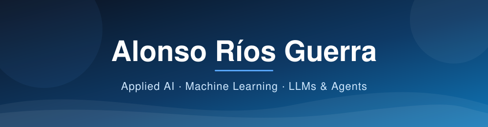

<h2 align="center">👨‍💻 About Me</h2>

<table>
<tr>
<td width="62%" valign="top">

I'm a **Computer Engineering** graduate from **Universidad Carlos III de Madrid**, passionate about **applied AI**: turning machine learning models and LLMs into useful products that solve real business problems.

I'm especially drawn to the **intersection of AI and business**, designing solutions that solve real problems and can be explained to non-technical people. I'm growing towards **AI engineering and architecture**, and towards leading AI projects.

- 🔭 **Interests:** applied AI, machine learning, LLM agents, technology and business
- 🗣️ **Languages:** Spanish (native) · English (C1)
- 📍 **Based in:** Madrid, Spain

</td>
<td width="38%" valign="middle" align="center">

</td>
</tr>
</table>

<h2 align="center">🤖 What I Build</h2>

<table>
<tr>
<td width="33%" valign="top" align="center">
<h3>🧠 Machine Learning</h3>

Predictive and unsupervised models, from data preparation to evaluation: employee attrition prediction and clustering.

</td>
<td width="33%" valign="top" align="center">
<h3>💬 LLM Applications</h3>

Systems that combine <b>ML models with LLM APIs</b> to interpret results and generate recommendations. My thesis project.

</td>
<td width="33%" valign="top" align="center">
<h3>🛠️ AI Agents</h3>

<b>Conversational agents with tools</b> that run database queries to answer questions with real data.

</td>
</tr>
</table>

<h2 align="center">🧰 Tech Stack</h2>

<table align="center">
<tr>
<td align="right"><b>AI &amp; Data</b></td>
<td>&nbsp;&nbsp;&nbsp;&nbsp;&nbsp;&nbsp;&nbsp;&nbsp;&nbsp;&nbsp;</td>
</tr>
<tr>
<td align="right"><b>Languages</b></td>
<td></td>
</tr>
<tr>
<td align="right"><b>Backend &amp; Web</b></td>
<td></td>
</tr>
<tr>
<td align="right"><b>Databases</b></td>
<td>&nbsp;&nbsp;</td>
</tr>
<tr>
<td align="right"><b>Tools &amp; DevOps</b></td>
<td></td>
</tr>
</table>

<h2 align="center">📌 Featured Projects</h2>

<h2 align="center">📊 GitHub Stats</h2>

<h2 align="center">🤝 Let's Connect</h2>

Always happy to talk about <b>applied AI</b> and to collaborate on <b>real-world solutions</b>. Ask me about my projects, I love sharing them!

&nbsp;&nbsp;

  

<em>&ldquo;Turning ideas into code, and code into impact.&rdquo;</em>

